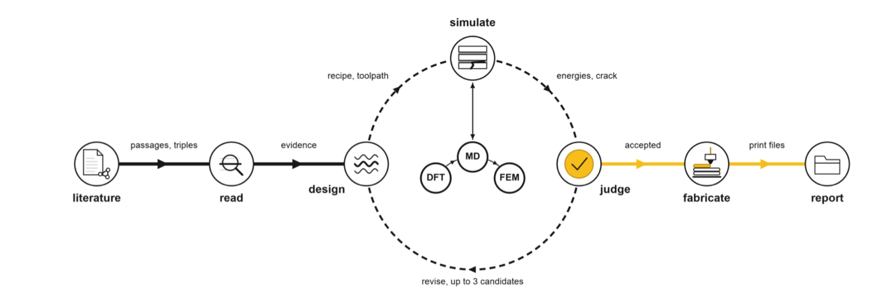
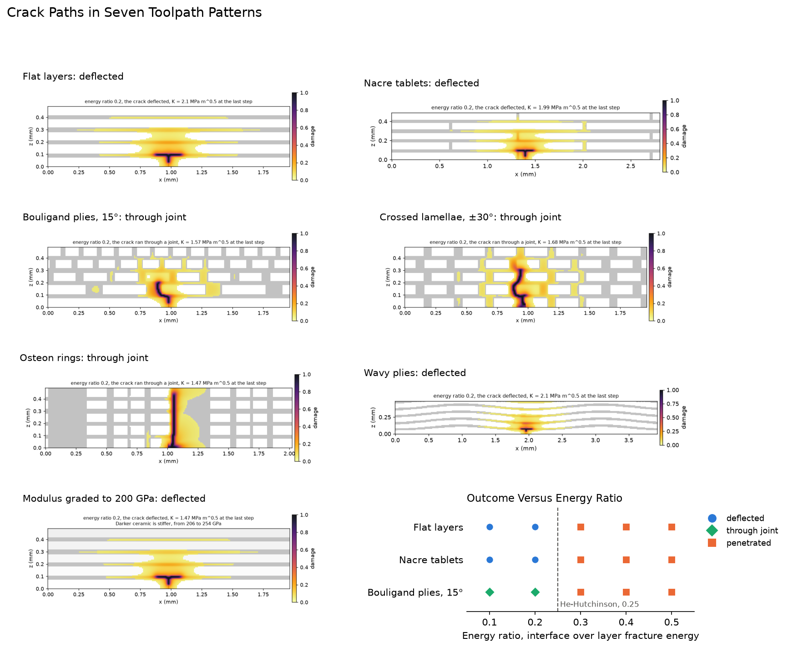

# BioinspiredCeramics: multi-agent design of bioinspired ceramic architectures for additive manufacturing

## Summary

A team of agents turns a design question into a printable ceramic architecture modeled on a biological material. The agents search a corpus of papers and its knowledge graph, state a hypothesis (a biological model, its toughening mechanism and a printing process) and choose the materials and dimensions with a cited source for every value. An architect agent turns the structure of the biological model into a toolpath pattern, such as staggered tablets, helicoidal plies or concentric rings, and code writes the part as STL files. An engineer agent then runs a chain of simulations on it, from density-functional theory through molecular dynamics to a phase-field fracture model of the printed architecture. A judge weighs each candidate against its simulation results and can send it back to the designer. The accepted candidate gets a novelty score against the corpus, a cited synthesis and fabrication recipe, and print files for the chosen process. Every model is open-weight and runs locally on one NVIDIA DGX Spark.



[pipeline/README.md](pipeline/README.md) shows the full agent graph.

## Knowledge graph traversal

The knowledge graph holds 635,919 triples (head, relation, tail) extracted from 2,767 papers. The agents use it in two ways, both matching terms in the text of a triple.

**Finding hypotheses.** Before the planner writes its queries, code looks for hypotheses that no single record states, a form of literature-based discovery [Swanson 1986]. A hypothesis fills six slots, namely biological model, mechanism, ceramic, process, interlayer and structure. The code enumerates every combination of the options and keeps those where at least one triple names each of six links.

```text
biological model ── mechanism ── ceramic ── process
       │                │           │
   structure ───────────┘       interlayer
```

For example, nacre with tablets has 913 triples, tablets with crack deflection 16, and crack deflection with alumina 6. Each link is well supported, while no passage, caption or triple names all six terms of the hypothesis. A combination is dropped when its interlayer separates from the ceramic at a quarter or more of the ceramic's cleavage energy, the He-Hutchinson ratio below which a crack deflects, with both energies read from the DFT and MD results. The rest rank by their weakest link, the link with the fewest triples, and the top three differ in at least half of the slots the question leaves free. One triple per link joins the evidence, and the designer may adopt a proposal and cite those triples.

**Looking up evidence.** The planner names entities for the design fields. In its first search round the retriever returns, for each entity and each design option, the 3 triples that mention it together with the most other entities. These are one-hop lookups, and they sit beside the passages and figures found by cosine similarity.

A triple shows only that two terms appear in one statement, so a proposal is a lead. Every numeric value in a design must still appear in the evidence line it cites. [pipeline/README.md](pipeline/README.md) gives the counts per link and question.

## Simulation chain

Each scale passes its result to the next. The ceramic is resolved to its crystal structure in the Materials Project.

| Scale | Tool | Method | Output |
|---|---|---|---|
| Electronic | [`dft_cleavage`](tools/dft/) | Quantum ESPRESSO, PBE, relaxed slab on the lowest-energy plane | cleavage energy of the ceramic, 3.11 J/m² for alumina (0001) and 5.82 J/m² for silicon carbide (110) |
| Atomistic | [`md_interface`](tools/md/) | MACE-MP-0 with D3 dispersion, interlayer packed and equilibrated at 300 K, then split at the interface and inside the interlayer | separation energy and strength of the weaker of the two |
| Meso | [`fem_fracture`](tools/fem/) | AT2 phase field (jax-pfczm) on a section of the printed architecture, under a rising mode-I load | whether a crack from the notch deflects along the interlayer, runs through a joint of the pattern, or penetrates the next ply |

[tools/README.md](tools/README.md) gives the contract each tool meets and the handoff file that records the origin of every input.

## Installation

```bash
git clone git@github.com:lmarom/BioinspiredCeramics.git
cd BioinspiredCeramics
python -m venv .venv && source .venv/bin/activate
pip install -r requirements.txt
cp .env.example .env   # add MP_API_KEY
```

On a DGX Spark, `bash pipeline/scripts/setup_spark.sh` also installs Ollama without root, pulls the three default models (36 GB) and runs the check. The DFT and MD tools run in their own environments, described in [tools/dft/README.md](tools/dft/README.md) and [tools/md/README.md](tools/md/README.md).

## Quick start

```bash
python -m pipeline.run "Design a nacre-inspired alumina laminate made by direct ink writing with a polymer interlayer, and check whether a crack deflects." <corpus>/
```

A run writes `runs/<time>/` with the report, every agent's input and output, and per candidate the design, the geometry, the three tool handoff files, the verdict and the novelty score. [`pipeline/scripts/build_corpus.py`](pipeline/scripts/build_corpus.py) builds a corpus from papers converted to markdown and their knowledge-graph triples. [`notebooks/walkthrough.ipynb`](notebooks/walkthrough.ipynb) runs one question cell by cell.

## Example

[examples/example_run/](examples/example_run/) holds one complete run, with its report, design, STL files, tool outputs and print files.



## Repository layout

```text
pipeline/          agents, graph, design fields, toolpath patterns, geometry, fabrication, novelty, tests, benchmark
tools/             dft/, md/ and fem/ solvers with their cached results, and the Materials Project resolver
knowledge_graph/   scripts that build the knowledge graph from a Web of Science export
notebooks/         walkthrough of one run
examples/          outputs of one run
docs/              benchmark of 20 open-weight models, hardware, model choice, figures
```

[pipeline/README.md](pipeline/README.md) describes the agents, the toolpath grammar and the run output. [knowledge_graph/README.md](knowledge_graph/README.md) covers the corpus and graph build, and [docs/benchmark.md](docs/benchmark.md) the model benchmark.

## Reference

```bibtex
@misc{marom2026bioinspiredceramics,
  title  = {BioinspiredCeramics: multi-agent design of bioinspired ceramic architectures for additive manufacturing},
  author = {Marom, Lee},
  year   = {2026},
  note   = {Laboratory for Atomistic and Molecular Mechanics, MIT},
  url    = {https://github.com/lmarom/BioinspiredCeramics}
}
```

The solvers include jax-pfczm and fracture-md by Jaime Berkovich and md_agent by Alex Wang, each with its source and license in its folder. The knowledge-graph extraction follows [GraphReasoning](https://github.com/lamm-mit/GraphReasoning). Released under the Apache 2.0 license.
