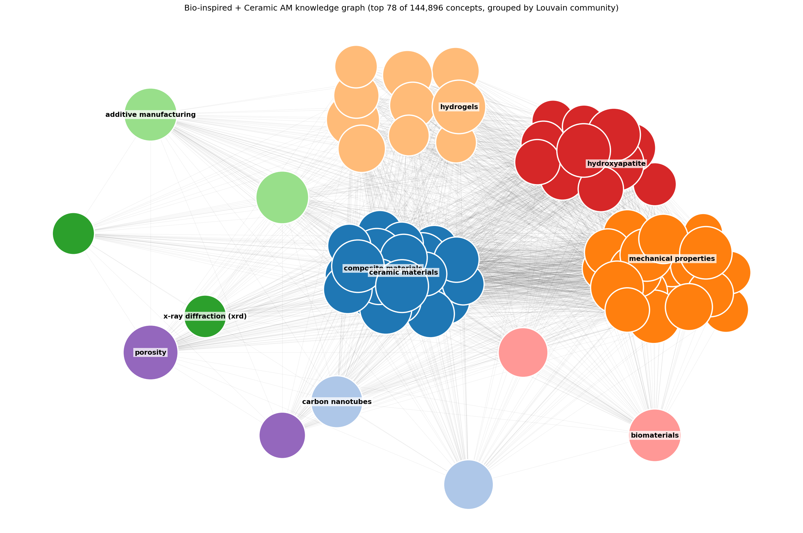

# Multiagent Discovery for Bioinspired Ceramics

> Ongoing research exploring multi-agent AI for materials discovery in
> bioinspired ceramic composites. **This repository currently contains
> the foundation:** an end-to-end pipeline that turns a Web of Science
> search into a deduplicated, community-clustered knowledge graph of
> scientific concepts. 



> **Example output.** The image above is from a sample run on ~2,800
> materials-science papers (bio-inspired materials + ceramic additive
> manufacturing). Each colored region is a Louvain community; the labeled
> node is its highest-degree concept. Your output will look different
> depending on the input corpus.
>
> **For interactive exploration** of the full graphml file produced by
> this pipeline, open it in [Gephi](https://gephi.org) or
> [Cytoscape](https://cytoscape.org) — both handle 100K+ node graphs
> gracefully and have proper community filters, search, and force-directed
> layouts.

End-to-end pipeline to build a deduplicated concept-relationship knowledge
graph from any Web of Science search. Given a WoS export, the pipeline:

1. Deduplicates and classifies papers by publisher
2. Downloads full-text PDFs through publisher-provided APIs
3. Converts PDFs to markdown with GPU-accelerated OCR (Marker / Surya)
4. Strips front/back matter and non-figure images
5. Extracts a concept-relationship knowledge graph using the
   [`graphPrompt`](https://github.com/lamm-mit/GraphReasoning) pipeline
   from the LAMM lab at MIT 
6. Merges synonymous nodes via embedding-based clustering and runs Louvain
   community detection on the result

The data folder (`data/`) is gitignored — when you clone this repo,
`data/` will be empty. Drop your own WoS export into `data/metadata/` and
run the scripts; they create everything else.

## Setup

```bash
# Clone, then:
cd <this-repo>

# Create a virtual environment and install dependencies
python -m venv .venv
source .venv/bin/activate
pip install -r requirements.txt

# Copy the env template and fill in your API keys
cp .env.example .env
# Edit .env — see docs/api_setup.md for where to get each key
```

Required API keys: Wiley TDM, Elsevier, Springer Nature (OA + Meta), OpenAI.
See [docs/api_setup.md](docs/api_setup.md) for registration links and notes on
what each provides.

## Quick start

```bash
# 1. Prep metadata (deduplicate, classify by publisher)
python dataset_kg/01_prep_metadata.py \
    --input data/metadata/wos_export.xls \
    --output data/metadata/corpus.csv

# 2. Download PDFs (uses publisher APIs)
python dataset_kg/02_download_pdfs.py \
    --metadata data/metadata/corpus.csv \
    --output-dir data/pdfs

# 3. Convert PDFs to markdown (GPU recommended)
python dataset_kg/03_pdf_to_markdown.py \
    --pdf-dir data/pdfs \
    --output-dir data/markdown

# 4. Trim front/back matter and filter non-figure images
python dataset_kg/04_trim_markdown.py \
    --input-dir data/markdown

# 5. Extract knowledge graph triplets
python dataset_kg/05_extract_kg.py \
    --input-dir data/markdown \
    --output-dir data/kg

# 6. Deduplicate synonymous nodes via embeddings (GPU recommended)
python dataset_kg/06_dedup_kg.py \
    --triplet-dirs data/kg/triplets \
    --output-dir data/kg/dedup
```

See [docs/pipeline.md](docs/pipeline.md) for a full walkthrough including
expected output at each stage.

## Scripts

| Script                      | Purpose                                                       | Dependencies |
|-----------------------------|---------------------------------------------------------------|--------------|
| `01_prep_metadata.py`       | Parse WoS export, dedup, classify publishers                  | pandas, requests |
| `02_download_pdfs.py`       | Download PDFs via Wiley / Elsevier / Springer / Unpaywall     | requests |
| `03_pdf_to_markdown.py`     | Marker OCR batch conversion                                   | marker-pdf (GPU) |
| `04_trim_markdown.py`       | Strip non-content sections and uncaptioned images             | (stdlib only) |
| `05_extract_kg.py`          | graphPrompt triplet extraction via OpenAI API                 | openai, networkx |
| `06_dedup_kg.py`            | Merge synonymous nodes via Gemma embeddings + community detection | sentence-transformers, python-louvain (GPU) |

## Pipeline architecture

```
WoS export (.xls/.csv)
         │
         ▼  01_prep_metadata.py
  metadata/corpus.csv        ← deduplicated + publisher-classified
         │
         ▼  02_download_pdfs.py      [publisher APIs + Unpaywall]
      pdfs/*.pdf
         │
         ▼  03_pdf_to_markdown.py    [Marker OCR on GPU]
   markdown/<doi>/<doi>.md + figures
         │
         ▼  04_trim_markdown.py
   trimmed markdown (title + abstract→conclusions)
         │
         ▼  05_extract_kg.py         [gpt-4o-mini, graphPrompt]
   kg/triplets/<doi>.json
   kg/knowledge_graph.graphml
         │
         ▼  06_dedup_kg.py           [EmbeddingGemma + community_detection on GPU]
   kg/dedup/knowledge_graph_dedup.graphml  ← synonyms merged, Louvain communities
   kg/dedup/canonical_map.tsv              ← original → canonical mapping
   kg/dedup/merge_clusters.tsv             ← every merged cluster for inspection
```

## Output formats

* **Metadata CSV** — WoS columns plus a `publisher` classification column
* **PDFs** — named `{doi_with_slashes_replaced_by_underscores}.pdf`
* **Markdown** — one subfolder per paper, containing `<doi>.md`, extracted
  images, and `<doi>_meta.json`
* **Knowledge graph** — one JSON file per paper with a list of
  `{node_1, edge, node_2, paper}` triplets, plus a merged `.graphml` file
  readable by Gephi, Cytoscape, or NetworkX

## Known limitations

* **Coverage is bounded by what your institution's TDM agreements allow.**
  Publishers without bulk text-and-data-mining APIs (Taylor & Francis,
  IOP, ACS without institutional IP, etc.) typically return only
  abstracts through programmatic routes. 
* Marker occasionally fails on scanned or heavily image-based PDFs. Rerun
  with `--force-ocr` to force the OCR path.
* Embedding-based dedup at threshold 0.88 with EmbeddingGemma's STS prompt
  produces clean synonym merges (e.g. `alumina ↔ aluminum oxide ↔ Al2O3`)
  while keeping most specific concepts distinct. A few related-but-distinct
  concepts may still merge under one canonical name. Inspect
  `data/kg/dedup/merge_clusters.tsv` after running and raise `--threshold`
  to 0.90+ if your domain needs stricter near-identical merging.

## Attribution

The triplet-extraction prompt and the dedup design follow the
[LAMM lab](https://github.com/lamm-mit)
[`GraphReasoning`](https://github.com/lamm-mit/GraphReasoning) and
[`GraphAgents`](https://github.com/lamm-mit/GraphAgents) work. The pipeline
here uses [`sentence_transformers.util.community_detection`](https://sbert.net/docs/package_reference/util.html)
in place of the brute-force similarity matrix in those repos so that the
dedup step scales to 400K+ nodes.
