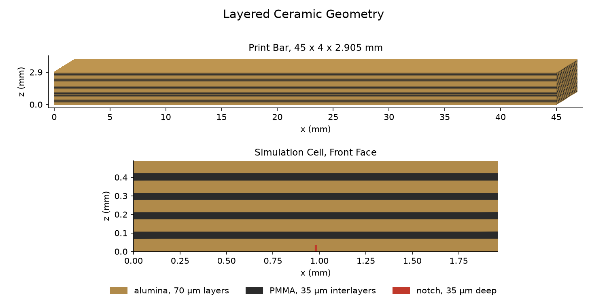
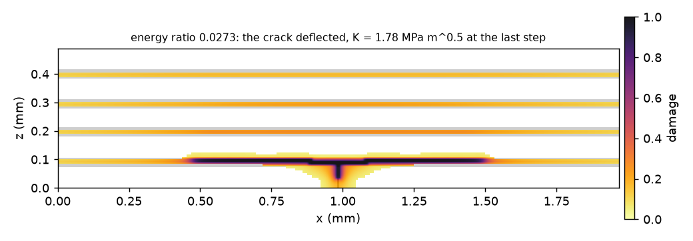
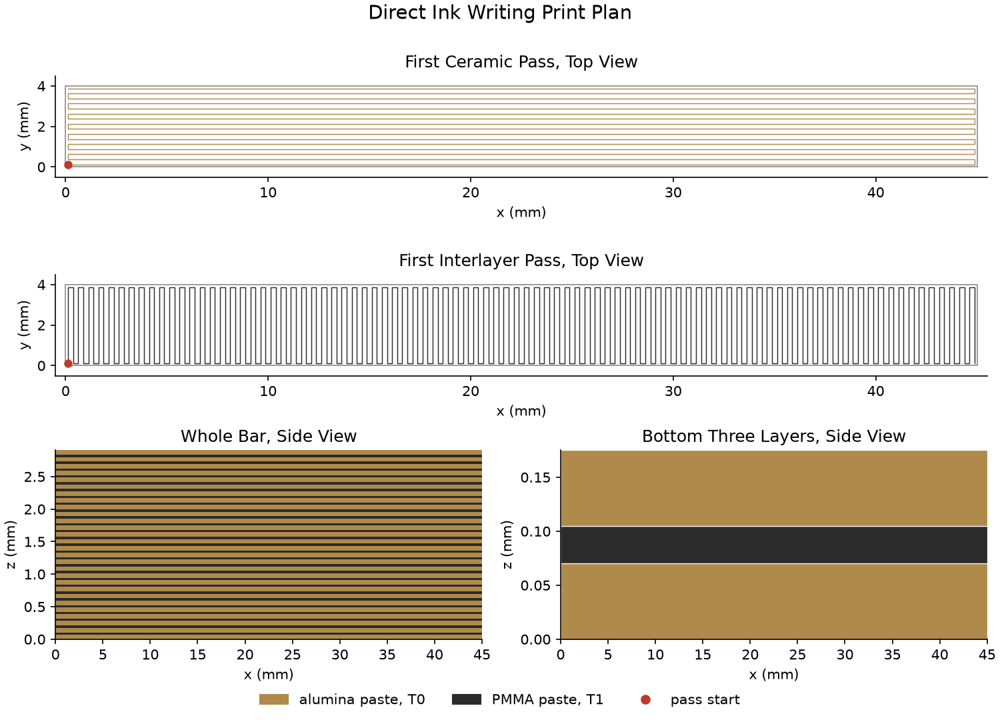

## Outcome
candidate_1 was accepted with a novelty of 0.23 against the corpus, below the target of 0.5, provisionally, since some tool results are stand‑ins.

## Question
Design a nacre‑inspired alumina laminate made by direct ink writing with a polymer interlayer, and check whether a crack deflects.

## Hypothesis
The best candidate uses a nacre biological model. The toughening mechanism is crack deflection. The laminate consists of alumina ceramic layers (70 µm thick, modulus 367 GPa) separated by a polymer interlayer (PMMA, 35 µm thick). Direct ink writing deposits the ceramic and polymer pastes in alternating layers, creating a laminated architecture that mimics the brick‑and‑mortar structure of nacre. The high modulus ceramic provides stiffness, while the compliant polymer interlayer promotes crack deflection along the interfaces, increasing fracture toughness.

## Simulation results
- **dft_cleavage**: Provides a cleavage energy of 3.0 J m⁻² for alumina. The method is a stand‑in; it is not a DFT calculation.
- **md_interface**: Gives a separation energy of 0.082 J m⁻² and a strength of 603 MPa for the alumina/PMMA interface. The method is a stand‑in based on a weaker‑material cleavage and binding‑energy relation, not an MD simulation.
- **fem_fracture**: Phase‑field fracture simulation (AT2, jax‑pfczm) shows that the crack deflects along the first interlayer for more than one ceramic layer thickness before entering the next ceramic layer. The simulation converged and reports `crack_deflects: true`. The cohesive length is 0.0828 µm, much smaller than the pixel size, indicating energy‑controlled fracture. The tool’s method is a phase‑field model, not a stand‑in.

## Judge's findings
| Candidate | Criterion | Met | Evidence |
|-----------|-----------|-----|----------|
| candidate_1 | A crack deflects along the interfaces. | **true** | fem_fracture output: `crack_deflects: true` |
| candidate_1 | The design meets every requirement that the question states. | **true** | design fields: biological_model="nacre", ceramic="alumina", process="direct ink writing", interlayer="PMMA" and fem_fracture confirms crack deflects |

The judge marks candidate_1 as provisional accept.

## What remains unverified
- **Stand‑in tools**: `dft_cleavage` and `md_interface` are marked as stand‑ins; their numerical values are not derived from first‑principles or explicit simulations.
- **Assumption‑based recipe values**: Several parameters in the fabrication recipe (e.g., binder percentages, mixing times, nozzle diameter, print speed) are sourced from “assumption” statements rather than experimental data.
- **Cross‑checks with large relative differences**: The cross‑check `md_bulk` reports a design layer modulus of 367 GPa, matching the source value. No cross‑check shows a relative difference exceeding 0.2.
- **Physical testing**: No part has been fabricated or mechanically tested; all conclusions are based on simulations and literature references.

## Candidates

| Candidate | biological_model | mechanism | process | ceramic | interlayer | Verdict | Novelty | Reward |
|---|---|---|---|---|---|---|---|---|
| candidate_1 | nacre | crack deflection | direct ink writing | alumina | PMMA | accept | 0.23 | 0.23 |
| candidate_2 | nacre | crack deflection | direct ink writing | alumina | epoxy | accept | 0.18 | 0.18 |
| candidate_3 | bone | crack bridging | vat photopolymerization | alumina | graphite | revise | 0.55 | 0.00 |

## Design of candidate_1

| Field | Value | Source |
|---|---|---|
| biological_model | nacre | 10.1016_j.addma.2023.103776#0: nacre-inspired composites |
| mechanism | crack deflection | 10.1016/j.addma.2023.103776: nacre-like toughening mechanisms include crack deflection |
| process | direct ink writing | 10.1016_j.addma.2023.103776#0: direct write 4D‑printing strategy for nacre‑inspired composites |
| ceramic | alumina | 10.1016_j.addma.2023.103776#0: alumina platelets used in nacre‑inspired composites |
| interlayer_thickness_um | 35 | 10.1016_j.actamat.2023.118704#12: interlayer thickness 35 µm |
| layer_modulus_GPa | 367 | 10.1016_j.jeurceramsoc.2023.11.009#6: Young's modulus of alumina 367 GPa |
| interlayer | PMMA | 10.3390/ma14226855: ceramic composites can be enhanced with ductile polymers such as PMMA |
| layer_thickness_um | 70 | 10.1016_j.actamat.2023.118704#12: shell thickness 70 µm |

## Figures

## Novelty of the best candidate

A nacre-inspired alumina laminate with PMMA interlayers, made by direct ink writing, toughened by crack deflection.

| Component | Value |
|---|---|
| score | 0.234375 |
| combination | 0.25 |
| semantic | 0.21875 |
| max_terms_together | 4 |
| records_with_max | 1 |
| closest_records | ['10.1016_j.actamat.2023.118704#30'] |
| nearest_passage | 10.1016_j.addma.2023.103776#0 |
| nearest_similarity | 0.5731545686721802 |

## Cross-checks

| Candidate | Check | Design value | Check value | Relative difference | Method |
|---|---|---|---|---|---|
| candidate_1 | md_bulk | 367 | 347.8 |  | md_agent, Pedone 2006 rigid-ion potential, perfect crystal relaxed at 0 K, C_ij by finite strain of 0.5% with relaxed ions, Voigt-Reuss-Hill average |
| candidate_2 | md_bulk | 367 | 347.8 |  | md_agent, Pedone 2006 rigid-ion potential, perfect crystal relaxed at 0 K, C_ij by finite strain of 0.5% with relaxed ions, Voigt-Reuss-Hill average |
| candidate_3 | md_bulk | 367 | 347.8 |  | md_agent, Pedone 2006 rigid-ion potential, perfect crystal relaxed at 0 K, C_ij by finite strain of 0.5% with relaxed ions, Voigt-Reuss-Hill average |

## Simulation outputs of candidate_1

| Tool | Inputs | Outputs | Method |
|---|---|---|---|
| dft_cleavage | material = alumina | cleavage_energy_J_m2 = 3.0 | stand-in (table of surface energies), not a DFT result |
| md_interface | material_a = alumina, material_b = PMMA | separation_energy_J_m2 = 0.082, strength_MPa = 603 | stand-in (weaker-material cleavage and binding-energy relation), not an MD result |
| fem_fracture | interface_fracture_energy_J_m2 = 0.082, interface_strength_MPa = 603, layer_fracture_energy_J_m2 = 3, layer_modulus_GPa = 367, layer_thickness_um = 70 | crack_deflects = True, energy_ratio = 0.027, criterion = deflects when the simulated crack runs along the first interlayer for more than one layer thickness on a side before it reaches the middle of the next ceramic layer, cohesive_length_over_layer_thickness = 0.0011823532577969348, he_hutchinson_deflects = True, outcome = deflected, along_interface_left_um = 485.92, along_interface_right_um = 485.92, into_next_layer_um = 0.0, interface_reached_K_MPa_sqrt_m = 1.7838, interface_broke_ahead_of_crack = True, layer_K_MPa_sqrt_m = 1.0837, band_energy_ratio = 0.035, pixel_um = 8.167, interlayer_band_um = 32.667, energy_balance = 0.014199069790649213, converged = True, seconds = 410.5, device = cpu:0 | phase-field fracture (AT2, jax-pfczm, l = 2 pixels) on a 60 x 241 pixel plane-strain section of the cell under a mode-I K-field. The cohesive length E G / s^2 is 0.0828 um against a pixel of 8.17 um, so the fracture is controlled by energy and the interface strength does not enter |
| md_bulk | alumina | youngs_modulus_GPa = 347.8, bulk_modulus_GPa = 274.4, shear_modulus_GPa = 134.9, density_g_cm3 = 4.061, n_atoms = 30, seconds = 1.9, design_layer_modulus_GPa = 367 | md_agent, Pedone 2006 rigid-ion potential, perfect crystal relaxed at 0 K, C_ij by finite strain of 0.5% with relaxed ions, Voigt-Reuss-Hill average |

## Simulation outputs of candidate_2

| Tool | Inputs | Outputs | Method |
|---|---|---|---|
| dft_cleavage | material = alumina | cleavage_energy_J_m2 = 3.0 | stand-in (table of surface energies), not a DFT result |
| md_interface | material_a = alumina, material_b = epoxy | separation_energy_J_m2 = 0.09, strength_MPa = 662 | stand-in (weaker-material cleavage and binding-energy relation), not an MD result |
| fem_fracture | interface_fracture_energy_J_m2 = 0.09, interface_strength_MPa = 662, layer_fracture_energy_J_m2 = 3, layer_modulus_GPa = 367, layer_thickness_um = 70 | crack_deflects = True, energy_ratio = 0.03, criterion = deflects when the simulated crack runs along the first interlayer for more than one layer thickness on a side before it reaches the middle of the next ceramic layer, cohesive_length_over_layer_thickness = 0.0010766996076549658, he_hutchinson_deflects = True, outcome = deflected, along_interface_left_um = 445.08, along_interface_right_um = 445.08, into_next_layer_um = 0.0, interface_reached_K_MPa_sqrt_m = 1.7838, interface_broke_ahead_of_crack = True, layer_K_MPa_sqrt_m = 1.0837, band_energy_ratio = 0.039, pixel_um = 8.167, interlayer_band_um = 32.667, energy_balance = 0.012940561297809499, converged = True, seconds = 370.1, device = cpu:0 | phase-field fracture (AT2, jax-pfczm, l = 2 pixels) on a 60 x 241 pixel plane-strain section of the cell under a mode-I K-field. The cohesive length E G / s^2 is 0.0754 um against a pixel of 8.17 um, so the fracture is controlled by energy and the interface strength does not enter |
| md_bulk | alumina | youngs_modulus_GPa = 347.8, bulk_modulus_GPa = 274.4, shear_modulus_GPa = 134.9, density_g_cm3 = 4.061, n_atoms = 30, seconds = 1.9, design_layer_modulus_GPa = 367 | md_agent, Pedone 2006 rigid-ion potential, perfect crystal relaxed at 0 K, C_ij by finite strain of 0.5% with relaxed ions, Voigt-Reuss-Hill average |

## Simulation outputs of candidate_3

| Tool | Inputs | Outputs | Method |
|---|---|---|---|
| dft_cleavage | material = alumina | cleavage_energy_J_m2 = 3.0 | stand-in (table of surface energies), not a DFT result |
| md_interface | material_a = alumina, material_b = graphite | separation_energy_J_m2 = 0.34, strength_MPa = 2502 | stand-in (weaker-material cleavage and binding-energy relation), not an MD result |
| fem_fracture | interface_fracture_energy_J_m2 = 0.34, interface_strength_MPa = 2502, layer_fracture_energy_J_m2 = 3, layer_modulus_GPa = 367, layer_thickness_um = 70 | crack_deflects = True, energy_ratio = 0.113, criterion = deflects when the simulated crack runs along the first interlayer for more than one layer thickness on a side before it reaches the middle of the next ceramic layer, cohesive_length_over_layer_thickness = 0.00028475563730812775, he_hutchinson_deflects = True, outcome = deflected, along_interface_left_um = 73.33, along_interface_right_um = 73.33, into_next_layer_um = 0.0, interface_reached_K_MPa_sqrt_m = 1.5739, interface_broke_ahead_of_crack = True, layer_K_MPa_sqrt_m = 1.0837, band_energy_ratio = 0.162, pixel_um = 5.867, interlayer_band_um = 17.6, energy_balance = 0.006272545816145145, converged = True, seconds = 181.0, device = cpu:0 | phase-field fracture (AT2, jax-pfczm, l = 2 pixels) on a 60 x 241 pixel plane-strain section of the cell under a mode-I K-field. The cohesive length E G / s^2 is 0.0199 um against a pixel of 5.87 um, so the fracture is controlled by energy and the interface strength does not enter |
| md_bulk | alumina | youngs_modulus_GPa = 347.8, bulk_modulus_GPa = 274.4, shear_modulus_GPa = 134.9, density_g_cm3 = 4.061, n_atoms = 30, seconds = 1.9, design_layer_modulus_GPa = 367 | md_agent, Pedone 2006 rigid-ion potential, perfect crystal relaxed at 0 K, C_ij by finite strain of 0.5% with relaxed ions, Voigt-Reuss-Hill average |

## Recipe

1. Ceramic feedstock preparation. Prepare a 35 vol% alumina paste using 99.99 % Al₂O₃ powder (D₅₀ = 0.2 µm). Add 30 wt% Pluronic F‑127 as binder and 1 wt% Dolapix CA as dispersant (weight relative to powder). Mix in a planetary mixer at 2000 rpm for 2 min, repeat 4 times, then defoam at 2200 rpm for 10 min. Store at room temperature.
   - powder: 99.99 % (10.1016_j.matdes.2022.111463#5)
   - particle_size: 0.2 µm (10.1016_j.matdes.2022.111463#5)
   - solids_loading: 35 vol% (10.1016_j.matdes.2022.111463#15)
   - binder: 30 wt% (10.1016_j.actamat.2023.118704#4)
   - dispersant: 1 wt% (10.1016_j.actamat.2023.118704#4)
   - mixing_rpm: 2000 rpm (10.1016_j.matdes.2022.111463#5)
   - mixing_time_min: 2 min (10.1016_j.matdes.2022.111463#5)
   - mixing_cycles: 4  (10.1016_j.matdes.2022.111463#5)
   - defoaming_rpm: 2200 rpm (10.1016_j.matdes.2022.111463#5)
   - defoaming_time_min: 10 min (assumption: 10.1016_j.matdes.2022.111463#5 does not state 10)
2. Interlayer (sacrificial graphite) paste preparation. Prepare a 35 vol% graphite/Al₂O₃ paste (50 vol% graphite, 50 vol% Al₂O₃) using the same binder and dispersant as the ceramic paste. Mix identically to the ceramic paste.
   - graphite_ratio: 50 vol% (assumption: 10.1016_j.actamat.2023.118704#5 does not state 50)
   - alumina_ratio: 50 vol% (assumption: 10.1016_j.actamat.2023.118704#5 does not state 50)
   - solids_loading: 35 vol% (10.1016_j.matdes.2022.111463#15)
   - binder: 30 wt% (10.1016_j.actamat.2023.118704#4)
   - dispersant: 1 wt% (10.1016_j.actamat.2023.118704#4)
   - mixing_rpm: 2000 rpm (10.1016_j.matdes.2022.111463#5)
   - mixing_time_min: 2 min (10.1016_j.matdes.2022.111463#5)
   - mixing_cycles: 4  (10.1016_j.matdes.2022.111463#5)
   - defoaming_rpm: 2200 rpm (10.1016_j.matdes.2022.111463#5)
   - defoaming_time_min: 10 min (assumption: 10.1016_j.matdes.2022.111463#5 does not state 10)
3. Printing. Co‑extrude the ceramic and sacrificial interlayer pastes using a direct ink writing system. Deposit ceramic layers of 70 µm thickness and interlayer layers of 35 µm thickness. Use a 250 µm nozzle, print speed 10 mm s⁻¹, travel speed 30 mm s⁻¹, max/min layer height fraction 0.8/0.3, syringe diameter 14.5 mm, z‑hop 1 mm, tool change 30 s.
   - nozzle_diameter_um: 250 µm (assumption: design)
   - max_layer_height_fraction: 0.8 nozzle diameters (assumption: design)
   - min_layer_height_fraction: 0.3 nozzle diameters (assumption: design)
   - print_speed_mm_s: 10 mm/s (assumption: design)
   - travel_speed_mm_s: 30 mm/s (assumption: design)
   - syringe_diameter_mm: 14.5 mm (assumption: design)
   - z_hop_mm: 1 mm (assumption: design)
   - tool_change_s: 30 s (assumption: design)
4. Debinding. Dry the green part at 30 °C, 72 % RH for 2 days. Cold‑isostatically press at 300 MPa for 5 min. Heat to 350 °C at 1 °C min⁻¹, hold 1 h, then to 500 °C at 2 °C min⁻¹, hold 2 h to burn out Pluronic.
   - dry_temp_c: 30 °C (10.1016_j.actamat.2023.118704#6)
   - dry_humidity_percent: 72 % (10.1016_j.actamat.2023.118704#6)
   - dry_time_days: 2 days (10.1016_j.actamat.2023.118704#6)
   - pressure_mpa: 300 MPa (10.1016_j.actamat.2023.118704#6)
   - press_time_min: 5 min (10.1016_j.actamat.2023.118704#6)
   - heat_rate_start_cmin: 1 °C/min (10.1016_j.actamat.2023.118704#6)
   - heat_start_c: 350 °C (10.1016_j.actamat.2023.118704#6)
   - hold_start_h: 1 h (10.1016_j.actamat.2023.118704#6)
   - heat_rate_burn_cmin: 2 °C/min (10.1016_j.actamat.2023.118704#6)
   - heat_burn_c: 500 °C (10.1016_j.actamat.2023.118704#6)
   - hold_burn_h: 2 h (10.1016_j.actamat.2023.118704#6)
5. Sintering. Sinter the part in air at 1550 °C for 1 h with a heating rate of 5 °C min⁻¹.
   - sinter_temp_c: 1550 °C (10.1016_j.actamat.2023.118704#6)
   - sinter_time_h: 1 h (10.1016_j.actamat.2023.118704#6)
   - sinter_rate_cmin: 5 °C/min (10.1016_j.actamat.2023.118704#6)
6. Post‑sintering infiltration. After sintering, infiltrate PMMA into the pores left by the burnt graphite interlayer. Heat the PMMA to 120 °C and apply under vacuum for 2 h to fill the pores.
   - pmma_infiltration_temp_c: 120 °C (assumption: infiltration temperature for PMMA)
   - pmma_infiltration_time_h: 2 h (assumption: infiltration time)
7. Finishing. Polish the sintered part to the desired surface finish. Inspect for residual porosity and interlayer integrity.

Print parameters

- nozzle_diameter_um: 250 µm (assumption: design)
- max_layer_height_fraction: 0.8 nozzle diameters (assumption: design)
- min_layer_height_fraction: 0.3 nozzle diameters (assumption: design)
- print_speed_mm_s: 10 mm/s (assumption: design)
- travel_speed_mm_s: 30 mm/s (assumption: design)
- syringe_diameter_mm: 14.5 mm (assumption: design)
- z_hop_mm: 1 mm (assumption: design)
- tool_change_s: 30 s (assumption: design)

Cautions

- Ensure the binder is fully removed before sintering to avoid cracking.
- Control the heating rate to prevent rapid gas evolution from the sacrificial graphite.
- PMMA infiltration must be performed under vacuum to avoid trapped air and ensure complete pore filling.
- Monitor the thermal expansion mismatch between alumina and PMMA to avoid delamination during cooling.
- Verify that the interlayer thickness remains 35 µm after infiltration; adjust infiltration parameters if necessary.

## Print files

| File | Path |
|---|---|
| gcode | candidate_1/fabrication/print.gcode |
| preview_png | candidate_1/fabrication/preview.png |
| render_png | candidate_1/geometry/render.png |
