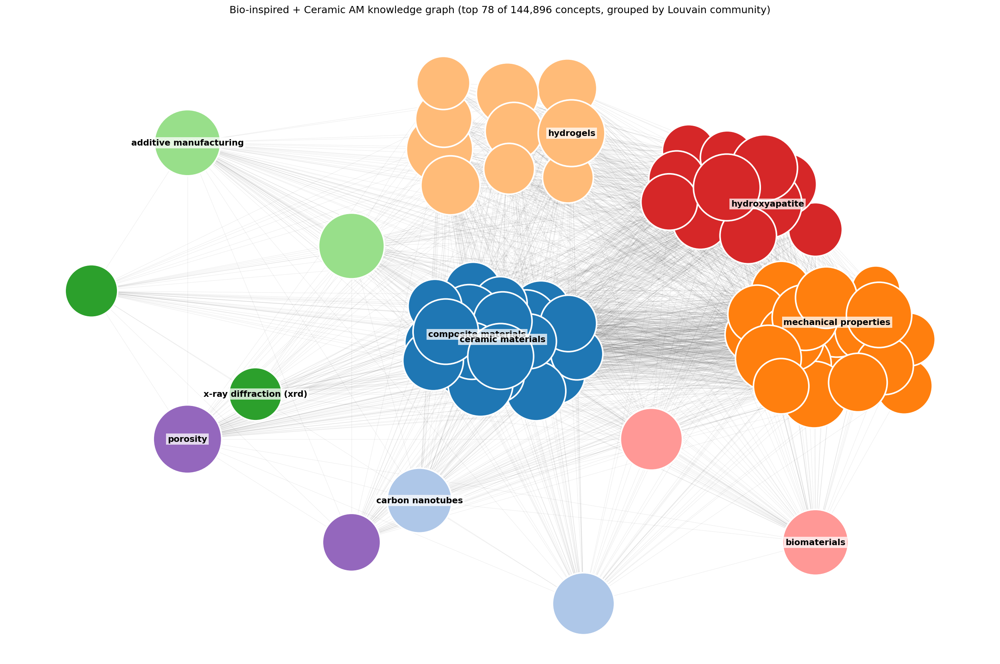

# Knowledge graph

The scripts in this folder turn a Web of Science search into a deduplicated, community-clustered knowledge graph of scientific concepts. The pipeline reads its triples, together with the passages and figures of the same papers, as its corpus ([../pipeline/README.md](../pipeline/README.md#corpus)). The knowledge graph and the DOI list can be found in [graph/](graph).



> **Example output.** The image above is from a sample run on ~2,800
> materials-science papers (bio-inspired materials + ceramic additive
> manufacturing). Each colored region is a Louvain community; the labeled
> node is its highest-degree concept. Your output will look different
> depending on the input corpus.
>
> **For interactive exploration** of the full graphml file produced by
> this pipeline, open it in [Gephi](https://gephi.org) or
> [Cytoscape](https://cytoscape.org), both handle 100K+ node graphs
> gracefully and have proper community filters, search, and force-directed
> layouts.

End-to-end pipeline to build a deduplicated concept-relationship knowledge
graph from any Web of Science search. Given a WoS export, the pipeline:

1. Deduplicates and classifies papers by publisher
2. Downloads full-text PDFs through publisher-provided APIs
3. Converts PDFs to markdown with GPU-accelerated OCR (Marker / Surya)
4. Strips front/back matter and non-figure images
5. Extracts a concept-relationship knowledge graph using the
   [`graphPrompt`](https://github.com/lamm-mit/GraphReasoning) pipeline
   from the LAMM lab at MIT 
6. Merges synonymous nodes via embedding-based clustering and runs Louvain
   community detection on the result

The data folder (`data/`) is gitignored, when you clone this repo,
`data/` will be empty. Drop your own WoS export into `data/metadata/` and
run the scripts; they create everything else.

## Setup

```bash
# Clone, then:
cd <this-repo>

# Create a virtual environment and install dependencies
python -m venv .venv
source .venv/bin/activate
pip install -r knowledge_graph/requirements.txt

# Copy the env template and fill in your API keys
cp .env.example .env
# Edit .env, see api_setup.md for where to get each key
```

Required API keys: Wiley TDM, Elsevier, Springer Nature (OA + Meta), OpenAI.
See [api_setup.md](api_setup.md) for registration links and notes on
what each provides.

## Quick start

```bash
# 1. Prep metadata (deduplicate, classify by publisher)
python knowledge_graph/01_prep_metadata.py \
    --input data/metadata/wos_export.xls \
    --output data/metadata/corpus.csv

# 2. Download PDFs (uses publisher APIs)
python knowledge_graph/02_download_pdfs.py \
    --metadata data/metadata/corpus.csv \
    --output-dir data/pdfs

# 3. Convert PDFs to markdown (GPU recommended)
python knowledge_graph/03_pdf_to_markdown.py \
    --pdf-dir data/pdfs \
    --output-dir data/markdown

# 4. Trim front/back matter and filter non-figure images
python knowledge_graph/04_trim_markdown.py \
    --input-dir data/markdown

# 5. Extract knowledge graph triplets
python knowledge_graph/05_extract_kg.py \
    --input-dir data/markdown \
    --output-dir data/kg

# 6. Deduplicate synonymous nodes via embeddings (GPU recommended)
python knowledge_graph/06_dedup_kg.py \
    --triplet-dirs data/kg/triplets \
    --output-dir data/kg/dedup
```

[Walkthrough](#walkthrough) below gives the expected output at each stage.

## Scripts

| Script                      | Purpose                                                       | Dependencies |
|-----------------------------|---------------------------------------------------------------|--------------|
| `01_prep_metadata.py`       | Parse WoS export, dedup, classify publishers                  | pandas, requests |
| `02_download_pdfs.py`       | Download PDFs via Wiley / Elsevier / Springer / Unpaywall     | requests |
| `03_pdf_to_markdown.py`     | Marker OCR batch conversion                                   | marker-pdf (GPU) |
| `04_trim_markdown.py`       | Strip non-content sections and uncaptioned images             | (stdlib only) |
| `05_extract_kg.py`          | graphPrompt triplet extraction via OpenAI API                 | openai, networkx |
| `06_dedup_kg.py`            | Merge synonymous nodes via Gemma embeddings + community detection | sentence-transformers, python-louvain (GPU) |

## Data flow

```
WoS export (.xls/.csv)
         │
         ▼  01_prep_metadata.py
  metadata/corpus.csv        ← deduplicated + publisher-classified
         │
         ▼  02_download_pdfs.py      [publisher APIs + Unpaywall]
      pdfs/*.pdf
         │
         ▼  03_pdf_to_markdown.py    [Marker OCR on GPU]
   markdown/<doi>/<doi>.md + figures
         │
         ▼  04_trim_markdown.py
   trimmed markdown (title + abstract→conclusions)
         │
         ▼  05_extract_kg.py         [gpt-4o-mini, graphPrompt]
   kg/triplets/<doi>.json
   kg/knowledge_graph.graphml
         │
         ▼  06_dedup_kg.py           [EmbeddingGemma + community_detection on GPU]
   kg/dedup/knowledge_graph_dedup.graphml  ← synonyms merged, Louvain communities
   kg/dedup/canonical_map.tsv              ← original → canonical mapping
   kg/dedup/merge_clusters.tsv             ← every merged cluster for inspection
```

## Output formats

* **Metadata CSV**, WoS columns plus a `publisher` classification column
* **PDFs**, named `{doi_with_slashes_replaced_by_underscores}.pdf`
* **Markdown**, one subfolder per paper, containing `<doi>.md`, extracted
  images, and `<doi>_meta.json`
* **Knowledge graph**, one JSON file per paper with a list of
  `{node_1, edge, node_2, paper}` triplets, plus a merged `.graphml` file
  readable by Gephi, Cytoscape, or NetworkX

## Notes

* **Coverage is bounded by what your institution's TDM agreements allow.**
  Publishers without bulk text-and-data-mining APIs (Taylor & Francis,
  IOP, ACS without institutional IP, etc.) typically return only
  abstracts through programmatic routes. 
* Marker occasionally fails on scanned or heavily image-based PDFs. Rerun
  with `--force-ocr` to force the OCR path.
* Embedding-based dedup at threshold 0.88 with EmbeddingGemma's STS prompt
  produces clean synonym merges (e.g. `alumina ↔ aluminum oxide ↔ Al2O3`)
  while keeping most specific concepts distinct. A few related-but-distinct
  concepts may still merge under one canonical name. Inspect
  `data/kg/dedup/merge_clusters.tsv` after running and raise `--threshold`
  to 0.90+ if your domain needs stricter near-identical merging.

## Attribution

The triplet-extraction prompt and the dedup design follow the
[LAMM lab](https://github.com/lamm-mit)
[`GraphReasoning`](https://github.com/lamm-mit/GraphReasoning) and
[`GraphAgents`](https://github.com/lamm-mit/GraphAgents) work. The pipeline
here uses [`sentence_transformers.util.community_detection`](https://sbert.net/docs/package_reference/util.html)
in place of the brute-force similarity matrix in those repos so that the
dedup step scales to 400K+ nodes.

## Walkthrough

Step-by-step commands and expected output at each stage. Assumes you have
completed the [setup](#setup) and filled in `.env`.

### Stage 1. Metadata prep

**Input:** A Web of Science search result exported as `.xls`, `.xlsx`, `.csv`,
or `.tsv`. To get one:

1. Run your query on <https://www.webofscience.com>
2. Click **Export → Excel** (or CSV)
3. Choose "Records from 1 to 1000" and a custom selection of fields that
   includes at least DOI, Article Title, Authors, Source Title, and
   Publication Year

**Command:**

```bash
python knowledge_graph/01_prep_metadata.py \
    --input data/metadata/wos_export.xls \
    --output data/metadata/corpus.csv
```

**Output:** `data/metadata/corpus.csv` with an added `publisher` column. The
script prints a summary of publishers:

```
--- Publisher breakdown ---
  Elsevier: 894
  Springer: 179
  Wiley: 165
  MDPI: 237
  ...
  TOTAL: 1,891

Wiley + Elsevier + Springer: 1,238 (65%)
```

If you already have a previous corpus and want to deduplicate, add
`--existing data/metadata/previous_corpus.csv`.

### Stage 2. PDF download

Tries publisher TDM APIs first, then Unpaywall as a fallback. A 5-second
delay between papers respects rate limits. **Before running at scale**,
read [`api_setup.md`](api_setup.md) to make sure your usage complies with
each publisher's terms.

**Command:**

```bash
python knowledge_graph/02_download_pdfs.py \
    --metadata data/metadata/corpus.csv \
    --output-dir data/pdfs
```

**Output:** One PDF per DOI named `10.xxxx_paperid.pdf` in `data/pdfs/`,
plus a `download_log.csv` recording success/failure per DOI.

**To retry failures** after fixing access issues:

```bash
python knowledge_graph/02_download_pdfs.py \
    --metadata data/metadata/corpus.csv \
    --output-dir data/pdfs \
    --retry-failed
```

### Stage 3. PDF to markdown (Marker OCR)

Marker uses Surya OCR on GPU to convert each PDF into a structured markdown
file. It handles multi-column layout, tables, equations, figures, and scanned
documents.

**Command:**

```bash
python knowledge_graph/03_pdf_to_markdown.py \
    --pdf-dir data/pdfs \
    --output-dir data/markdown
```

**Output:** For each `paper.pdf`, a subfolder `data/markdown/paper/` with:

* `paper.md`, the extracted markdown
* `paper_meta.json`, structural metadata
* `_page_N_Figure_M.jpeg`, extracted images (figures and decorative)

A CUDA GPU is strongly recommended; CPU works but is much slower.

**For PDFs where Marker fails** (output is tiny or empty):

```bash
python knowledge_graph/03_pdf_to_markdown.py \
    --pdf-dir data/pdfs \
    --output-dir data/markdown \
    --force-ocr
```

`--force-ocr` treats every page as a scanned image, which helps with
encrypted, scanned, or heavily image-based PDFs.

### Stage 4. Trim markdown

Strips the title page, journal headers, references, acknowledgements, and
decorative images, keeping just the paper title plus the scientific content
from Abstract through Conclusions.

**Command:**

```bash
python knowledge_graph/04_trim_markdown.py --input-dir data/markdown
```

Add `--dry-run` first to preview what will be removed.

**Effect:** Typically ~35% reduction in line count and deletion of
decorative images (journal logos, author photos, QR codes). Actual figures
with captions are preserved.

### Stage 5. Knowledge graph extraction

For each markdown paper, the
[`graphPrompt`](https://github.com/lamm-mit/GraphReasoning) pipeline
(LAMM lab, MIT) sends every 2,500-char chunk through three LLM calls:

1. Extract ~10 `(node, edge, node)` triplets
2. Standardize node names to consistent terminology for the field
   (the prompt currently asks for materials-science conventions; edit
   `SYS_PROMPT_FORMAT` in `knowledge_graph/05_extract_kg.py` for other domains)
3. Validate JSON format

**Command:**

```bash
python knowledge_graph/05_extract_kg.py \
    --input-dir data/markdown \
    --output-dir data/kg
```

**Output:**

* `data/kg/triplets/<paper>.json`, one JSON array per paper containing its
  extracted triplets
* `data/kg/knowledge_graph.graphml`, a merged NetworkX-compatible graph
  file readable by Gephi, Cytoscape, or Python tools

**Test on a few papers before the full run:**

```bash
python knowledge_graph/05_extract_kg.py \
    --input-dir data/markdown \
    --output-dir data/kg \
    --limit 5
```

This processes 5 papers and lets you see the actual triplet output before
committing to the full corpus.

### Stage 6. Embedding-based node deduplication

Raw triplets contain many synonyms, "alumina" / "Al2O3" / "aluminum oxide"
appear as three separate nodes that should be one. This stage merges them
using EmbeddingGemma-300m embeddings and `community_detection` from
sentence-transformers.

**Command:**

```bash
python knowledge_graph/06_dedup_kg.py \
    --triplet-dirs data/kg/triplets \
    --output-dir data/kg/dedup
```

To merge multiple corpora in one go (e.g. bio-inspired + ceramic-AM), pass
multiple `--triplet-dirs` arguments:

```bash
python knowledge_graph/06_dedup_kg.py \
    --triplet-dirs data/kg/bioinspired/triplets \
                   data/kg/ceramic_am/triplets \
    --output-dir data/kg/dedup
```

**Algorithm:**

1. Filter pathological node names (LaTeX math, pure quantities like "2 mm",
   single characters).
2. Embed every node with EmbeddingGemma using the **STS** (Semantic Textual
   Similarity) prompt.
3. Find clusters of near-duplicates with chunked GPU cosine via
   `sentence_transformers.util.community_detection` at `threshold=0.88`.
4. Pick a canonical name per cluster (highest in-graph degree wins;
   shortest label as tiebreaker).
5. Rebuild the graph with merged nodes and run Louvain community detection.

**Output:**

* `data/kg/dedup/node_embeddings.npy`, cached embeddings (~1.3 GB / 400K
  nodes); reusable via `--reuse-embeddings`
* `data/kg/dedup/nodes.txt`, node-name list aligned with the embeddings
* `data/kg/dedup/merge_clusters.tsv`, every merged cluster with its
  members; **inspect this** to verify quality
* `data/kg/dedup/canonical_map.tsv`, one row per remapped node:
  `original_name → canonical_name`
* `data/kg/dedup/knowledge_graph_dedup.graphml`, final graph with
  Louvain `community` attribute on each node

**Tuning:**

* `--threshold` (default 0.88). Raise to 0.90 if your domain needs
  stricter "must be near-identical" merging; lower to 0.85 to catch
  more typographically-distant variants at the cost of broader concepts
  occasionally absorbing specific ones.
* `--prompt` (default `STS`). Try `Retrieval-document` for cleaner
  unrelated/synonym separation at the cost of slightly weaker synonym
  matching. **Avoid `Clustering`, it groups by theme, not identity.**
* `--reuse-embeddings` skips the 8-min embed step when iterating on
  threshold or prompt.

