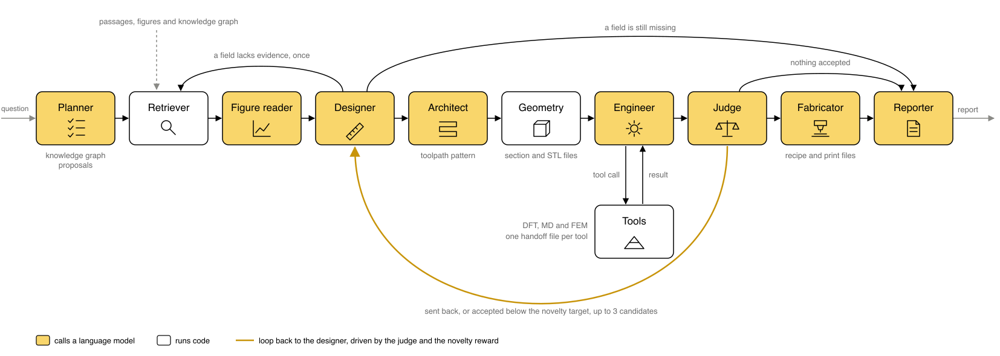

# Multi-agent pipeline

The agents turn a design question into a bioinspired ceramic that can be printed. They search a corpus of papers and a knowledge graph, state a hypothesis (a biological model, its toughening mechanism and an additive manufacturing process) and choose each design value with a cited source. They turn the structure of the biological model into a toolpath pattern, write the part as a section and STL files, and call DFT, MD and FEM tools with those values. A judge decides whether the candidate meets the criteria, and each candidate gets a novelty score against the corpus. The reward of a candidate is its novelty when the judge accepts it and 0 otherwise. A candidate the judge sends back, or an accepted one below the novelty target, returns the designer to work, for up to three candidates per run. The fabricator then writes the synthesis and fabrication recipe of the accepted candidate with the highest reward, with every number cited or marked as an assumption, and code turns its geometry into the print files of the chosen process. Every model is open-weight and served locally. The DFT tool computes the cleavage energy of the ceramic with Quantum ESPRESSO, the MD tool the separation of the ceramic from its interlayer with a machine-learned potential, and the FEM tool runs a phase-field simulation of the notched cell from both energies, as [../tools/README.md](../tools/README.md) describes.

## Agents



| Step | Default model | Reasoning | Job |
|---|---|---|---|
| planner | gpt-oss-20b | low | Writes search queries and knowledge-graph entities for the design fields, after code finds the knowledge graph proposals |
| retriever | EmbeddingGemma | | Finds passages and figures by cosine similarity, passages that hold a number with a field's unit or name one of its options, and knowledge-graph triples |
| figure reader | Qwen3.6-35B-A3B | off | Reads values from each retrieved figure, with the place in the figure each was read |
| designer | gpt-oss-20b | medium | Proposes a candidate with a cited source for every value, or asks once for another search |
| checker | gpt-oss-20b | medium | Reads the cited source of each numeric value a second time and confirms that the value belongs to the field |
| architect | gpt-oss-20b | medium | Reads evidence on the structure of the biological model and writes the toolpath pattern, with a source per parameter that code labels cited, derived, supported or assumption |
| geometry | none | | Writes the bend bar, the x-z section of the notched simulation cell and a voxel block of the cell per material, from the design and its toolpath pattern |
| engineer | gpt-oss-20b | low | Calls the tools in order and passes each result to the next call |
| judge | gpt-oss-20b | medium | Decides each criterion from the design and the tool outputs, and names the fields to change |
| cross-check | none | | Runs md_agent on the bulk ceramic and reports its moduli beside the layer modulus from the literature, for alumina |
| novelty | EmbeddingGemma | | Scores how rarely the corpus reports the hypothesis and the features of its pattern, from the terms its passages and triples share with them and from the distance of its statement to the nearest passage |
| fabricator | gpt-oss-20b | medium | Writes the feedstock, interlayer, print, debinding and sintering recipe from retrieved passages, citing each number |
| print files | none | | Writes G-code that walks the roads of every ply for direct ink writing, or a layer job for vat photopolymerization or binder jetting, and a print-plan figure |
| reporter | gpt-oss-20b | low | Writes the report with the hypothesis, the source of every value, the judge's findings and the recipe, above fixed sections with the figures, the tool outputs, the novelty and the files |

Code checks surround the models. A design value must appear in the evidence it cites, in the field's unit and within a range the source states, and the designer gets one repair with the findings. A material the tools do not accept, or a repeat of a candidate the judge sent back, is rejected the same way. A design that still lacks a field goes to the reporter, so no tool runs on it. The verdict follows from the judge's answer on each criterion. A tool that failed, or a tool input that matches no design value, geometry value or earlier tool output, leaves the candidate without a verdict. A recipe number is kept as cited only when the cited passage states it, and is otherwise marked as an assumption.

## Knowledge graph proposals

Before the planner writes its queries, `novelty.proposals()` looks in the knowledge graph for hypotheses that no single record names whole, a form of literature-based discovery [Swanson 1986]. A record is a passage, a figure caption or a triple, the unit the combination novelty counts. A hypothesis is one option per categorical field, biological model, mechanism, ceramic, process and interlayer, plus one structure, a pattern feature such as tablets or helicoidal plies. At least one triple must name each of its six links, which are biological model with mechanism, mechanism with ceramic, ceramic with process, ceramic with interlayer, biological model with structure, and structure with mechanism. No record may name all six terms, while one paper may name them across several records. A rule at the level of papers left the targeted questions without proposals, since a review names most options of the field somewhere in its text.

Every option and structure the question names must be in the hypothesis. The process is direct ink writing, the only process whose toolpath prints a structure. The interlayer must separate from the ceramic at under a quarter of the cleavage energy of the ceramic, the He-Hutchinson ratio below which a crack deflects, with both energies read from the DFT and MD results. Hypotheses rank by their weakest link, the number of triples that name it, and then by the triples of all six links. Each of the three proposals differs from the earlier ones in at least half of the slots the question leaves free.

The planner is told the proposals, and one triple per link joins the evidence, preferably one whose head names one term and whose tail the other. The designer may choose a proposal and cite those triples for its categorical fields. The architect is then told which pattern parameters carry the structure, for example `break_length_h` for tablets and `ply_rotation_deg` for helicoidal plies (`CARRIES` in `novelty.py`). The report lists the proposals and the candidates that took them. Each e2e row records whether a candidate took a proposal and whether its pattern has the structure.

On the full corpus of 635,919 triples from 2,767 papers, the first question takes 27 to 41 s and later ones under 1 s, since the term masks are cached. The energy rule excludes silica glass on both ceramics, since it separates at 0.35 of the cleavage energy of silicon carbide and 0.88 of that of alumina. The open question gets three hypotheses of silicon carbide with graphite and crack deflection, Bouligand with helicoidal plies, bone with concentric rings and nacre with tablets. Their weakest link is crack deflection with silicon carbide, 8 triples. The nacre and Bouligand questions each get alumina with epoxy, PMMA or graphite, with crack deflection and alumina as the weakest link at 6 triples. The graded question gets bone with alumina and the same three interlayers, whose weakest link, graded modulus with crack deflection, has 2 triples. The best single record of each proposal names 4 or 5 of its 6 terms.

The structure links are strong toward the organism and weak toward the mechanism. Bouligand with helicoidal plies has 1,657 triples, bone with concentric rings 964, nacre with tablets 913, conch shell with crossed lamellae 371, tooth enamel with graded modulus 46 and fish scale with helicoidal plies 41. Crack deflection has 16 triples with tablets, 13 with concentric rings, 12 with helicoidal plies, 10 with wavy interfaces and 2 with graded modulus. Of eight other biological models tried, two have more than two triples that tie them to one of the three mechanisms, tooth enamel and dentin with 6 to crack deflection and fish scale with 4 to crack bridging, so these two join the options. Wood, bamboo, turtle carapace, crustacean exoskeleton, glass sponge and seashell have 2 or fewer.

A triple shows only that two terms appear in one statement. The link from crack deflection to silicon carbide rests on SiC whiskers in MoSi2, and the link from alumina to graphite on a graphite filler that lowers the friction of an alumina coating. A proposal is a lead for the designer to check against passages, and every numeric field must still appear in the evidence line it cites.

## Toolpath patterns

In direct ink writing the toolpath is the structure. `pattern.py` describes the structure of a design as a toolpath pattern, a few primitives with dimensionless parameters, and an architect agent chooses the pattern from evidence on the structure of the biological model. `material()` gives the phase, ply and modulus at any point of the bar, and `roads()` gives the toolpaths of one ply from the same formulas, so the section the crack tool simulates, the STL files and the G-code describe one part. Lengths are in road widths w or in ceramic layer thicknesses h, so a ratio measured in an organism carries over while its absolute size does not. The road width is 1.2 ply pitches, the filament diameter for a z-spacing of one pitch [Zhou 2023], where a pitch is h plus the interlayer thickness. For 70 µm layers and 35 µm interlayers a road is 126 µm wide.

| Parameter | Default | Range | Meaning |
|---|---|---|---|
| `road_path` | lines | lines, waves, rings | Shape of the roads in a ply. Rings are concentric around the centers of a square grid |
| `road_angle_deg` | 0 | -90 to 90° | Direction of the roads of the bottom ply, from the bar length |
| `wave_amplitude_w`, `wave_length_w` | 0 | 0 to 5 w, 0 to 500 w | Amplitude and wavelength of wavy roads |
| `ring_spacing_w` | 0 | 0 to 500 w | Distance between neighboring ring centers |
| `break_length_h` | 0 | 0 to 1000 h | Length of a road segment between two breaks, the aspect ratio of a tablet. 0 keeps roads continuous |
| `break_shift` | 0.5 | 0 to 1 | Shift of the breaks from one ply to the next, in segment lengths |
| `ply_rotation_deg` | 0 | -90 to 90° | Rotation of the road direction from one ply to the next |
| `ply_rotation_alternates` | false | false, true | True turns the roads back and forth between two directions `ply_rotation_deg` apart |
| `ply_wave_amplitude_h`, `ply_wave_length_h` | 0 | 0 to 1 h, 0 to 2000 h | Amplitude and wavelength of a wave of the plies along the bar length, printed by non-planar toolpaths |
| `interlayer_placement` | sheet | sheet, shell | Sheet puts the interlayer between plies only. Shell also wraps every road, so neighboring roads and road ends meet at a weak interface |
| `modulus_profile` | uniform | uniform, linear, power | How the ceramic modulus changes from mid-thickness to both faces, by mixing two pastes |
| `outer_layer_modulus_GPa` | none | 1 to 1500 GPa | Modulus of the outermost plies of a graded profile |
| `profile_exponent` | 1 | 0.1 to 10 | Exponent of the power profile |

A biological structure maps onto one or two primitives. The examples below are the patterns the tests use.

| Structure | Parameters | Example |
|---|---|---|
| Nacre, tablets in brick and mortar | breaks set the tablet aspect ratio, and shells surround every tablet | `{"break_length_h": 20, "interlayer_placement": "shell"}` |
| Bouligand, helicoidal plies | the ply rotation is the pitch angle | `{"ply_rotation_deg": 15, "interlayer_placement": "shell"}` |
| Conch shell, crossed lamellae | an alternating rotation crosses the roads of neighboring plies | `{"road_angle_deg": -30, "ply_rotation_deg": 60, "ply_rotation_alternates": true, "interlayer_placement": "shell"}` |
| Bone, osteons | rings, with the ring spacing as the osteon spacing | `{"road_path": "rings", "ring_spacing_w": 8, "interlayer_placement": "shell"}` |
| Sutures | wavy roads | `{"road_path": "waves", "wave_amplitude_w": 1, "wave_length_w": 10, "interlayer_placement": "shell"}` |
| Wavy tablets | ply waves with breaks | `{"ply_wave_amplitude_h": 0.5, "ply_wave_length_h": 30, "break_length_h": 20}` |
| Modulus gradient | a graded profile with the modulus of the faces | `{"modulus_profile": "linear", "outer_layer_modulus_GPa": 250}` |

`pattern_errors` rejects a pattern that a nozzle cannot print or that adds nothing to flat layers. Waves need a wavelength of at least 4 w, ring centers sit at least 3 w apart, a tablet is at least 2 w long, and a ply wave keeps its slope below 30° so that the nozzle clears the road it just printed. Under sheet placement, waves, rings or a ply rotation leave no interface inside a ply, so they need shells or breaks. A parameter that acts only with another is rejected without it, such as a wave amplitude on straight roads or an outer modulus under a uniform profile, so a pattern cannot claim a feature the part lacks. Only direct ink writing prints a pattern other than flat layers of one modulus.

The geometry step writes the part for the crack tool and the print files. The cell is the bottom five plies at mid-length, with a notch half a layer thickness deep entering the bottom ply. It is two pattern periods wide, kept within 4 to 8 cell heights. `cell_section.npz` samples `material()` on the x-z section of the cell at 2 µm pixels, with phase, ply and modulus per pixel, on a plane through the middle of a bottom-ply road. `cell_ceramic.stl` and `cell_interlayer.stl` are closed voxel surfaces of a block of the cell, 24 voxels across its height and two road widths deep around the section plane. `bar_outline.stl` is the box of the bend bar, whose toolpaths are in the print files. `render.png` shows the section and the roads of the bottom three plies.

The crack tool is a 2D plane-strain model of that section. It sees a ply rotation, rings or waves only as the bands of interlayer where the section cuts the roads, and it cannot follow a crack that twists between rotated plies or leaves the section plane. A three-dimensional pattern such as a Bouligand stack is judged on one section.

## Output of a run

```text
runs/<time>/
  report.md  state.json
  candidate_1/
    design.json      the design values and the toolpath pattern, with the source of each
    geometry/        geometry.json, cell_section.npz, bar_outline.stl, cell_ceramic.stl, cell_interlayer.stl,
                     render.png, and the damage map and load path of the crack simulation
    handoff/         dft.json md.json fem.json, the parameters passed to each tool with their origins, and the outputs
    verdict.json     the judge's finding on each criterion and the reward
    novelty.json     the novelty score, its two components and the closest prior records
    cross_checks.json  the MD moduli of the bulk ceramic beside the design's layer modulus
    recipe.json      for the best candidate, the synthesis and fabrication recipe with a source per number,
    recipe.md        and the same as text
    fabrication/     for the best candidate, the print files of the chosen process and preview.png
  candidate_2/       written when the judge sends candidate_1 back or its novelty is below the target
```

`state.json` holds every agent's input and output, and every model call with its latency and token counts.

## Running

Commands run from the repository root. On a DGX Spark the setup script builds the Python environment with GPU JAX, installs Ollama in the home folder without root, serves it with a 32K context, pulls the three default models (36 GB), generates the benchmark charts and runs the check.

```bash
bash pipeline/scripts/setup_spark.sh
```

```bash
.venv/bin/python -m pipeline.run "Propose a bioinspired layered ceramic made by additive manufacturing whose interfaces deflect cracks. Choose the biological model and its mechanism, the ceramic, the interlayer, the print process and the layer thicknesses, and check whether a crack deflects." <corpus>/
```

`python -m pipeline.check` tests the server, each model, image input, one tool call, JAX on the GPU and the tools. The agents need only an OpenAI-compatible endpoint, so a laptop can run them against the Spark's server through an SSH tunnel.

```bash
ssh -N -L 11434:localhost:11434 <user>@<spark-host>
```

```bash
LLM_BASE_URL=http://localhost:11434/v1 python -m pipeline.run "<question>" <corpus>/
```

## Corpus

No corpus is part of this repository. `scripts/build_corpus.py` turns papers converted to markdown, for example by Marker, into `chunks.jsonl`, with one record per passage of up to about 2,000 characters and one per figure with its caption. It turns per-paper triple files, JSON lists of `node_1`, `node_2`, `edge` and `paper`, into `kg.jsonl`. The first load embeds every record and caches the vectors in the corpus folder.

```bash
python pipeline/scripts/build_corpus.py <markdown_papers>/ <corpus>/ <triples>/
```

## Changing the problem

`design.py` holds everything about the design problem. `DESIGN` lists the fields the designer fills, each with a description of the evidence it needs. `UNIT`, `SCALE` and `RANGE` tell the source check how to find a numeric value, and `ASK` is the checker's question for each numeric field. `make_geometry` builds the part, and `CRITERIA` lists what the judge decides. `pattern.py` holds the pattern parameters and their checks, `fabrication.py` the processes and their print parameters, and `novelty.py` the score and the spellings of each option and pattern feature. The tools live in [../tools/](../tools/). The prompts in `graph.py` do not name the problem, so a new problem needs new fields, criteria and tools, and no prompt changes.

| Field | What the designer supplies |
|---|---|
| `biological_model` | The biological material or structure the design copies, in free text as the evidence names it |
| `mechanism` | Its toughening mechanism, one of crack deflection, crack bridging and compressive residual stress |
| `process` | The additive manufacturing process, one of direct ink writing, vat photopolymerization and binder jetting |
| `ceramic` | The layer material, one of the materials the tools accept |
| `interlayer` | The material between layers, chosen so that cracks deflect along it |
| `layer_modulus_GPa` | Young's modulus of the ceramic, as stated in the evidence |
| `layer_thickness_um` | The thickness of one ceramic layer, within the range of layers the evidence reports as made or tested |
| `interlayer_thickness_um` | The thickness of the interlayer, within the range the evidence reports |

## Tests

The tests need no model server. `test_geometry` compares the section with analytic fractions for flat layers, shells and tablets, and checks that every road lies in ceramic, in under 3 s. `test_novelty` checks the proposals on corpora of a few triples. `test_graph` stubs the models and the search, and covers the knowledge graph proposals, the repair loop, the second reading, the geometry and handoff files, the judge loop, the novelty reward, the recipe check, the print files and the report sections. `test_graph` and `test_fem_tool` run the crack tool on a coarse grid of 30 pixel rows, set by `FEM_ROWS`, so that each call takes seconds. `test_graph` then takes about four minutes on six CPU cores.

```bash
python -m pipeline.tests.test_source_check
python -m pipeline.tests.test_geometry
python -m pipeline.tests.test_graph
python -m pipeline.tests.test_fem_tool
python -m pipeline.tests.test_fabrication
python -m pipeline.tests.test_novelty
```

## Hardware, models and benchmark

[docs/hardware.md](../docs/hardware.md) gives the hardware requirements and the memory budget, [docs/models.md](../docs/models.md) the model of each agent and the alternatives, and [docs/benchmark.md](../docs/benchmark.md) the benchmark of 20 open-weight models with every result.

`benchmark/run.py` scores models on chart reading, figure reading, passage extraction and tool calling, `speed.py` measures load time, memory and decode speed, `e2e.py` runs the whole graph for three model sets, and `report.py` summarizes the result files. `make_charts.py` generates the 20 chart items. The figure and passage items are taken from published papers and are kept outside the repository, so those two suites run only when their item files are copied into `benchmark/data/`. The tool suite keeps the two-tool chain it was measured with, so its scores stay comparable.
