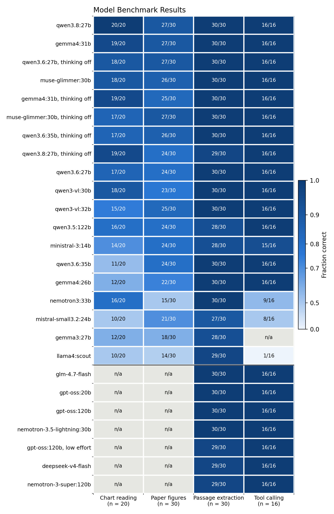

# Corpus-to-Simulation Agents

A basic multi-agent harness that reads a corpus of papers and a knowledge graph, turns the evidence into design parameters, and calls simulation tools with them. Every model is open-weight and served locally from one NVIDIA DGX Spark. The harness is under 400 lines of Python on LangGraph.

The bundled example designs a nacre-inspired layered alumina whose interfaces deflect cracks. The agents search eight open-access papers, read their figures, and choose an interlayer and a layer thickness with a cited source for every value. They then call a molecular-dynamics tool for the interface energies and a finite-element crack tool for the deflection check. Both tools are stand-ins with the interfaces of real solvers, so the pipeline runs end to end without the solvers. One run takes about 1.5 minutes on the Spark.

## Agents


| Agent | Default model | Reasoning | Job |
|---|---|---|---|
| planner | gpt-oss-20b | low | Writes search queries and knowledge-graph entities for the design fields |
| retriever | EmbeddingGemma | | Finds passages and figures by cosine similarity, passages that hold a number with a field's unit or name one of its options, and knowledge-graph triples |
| figure reader | Qwen3.6-35B-A3B | off | Reads values from each retrieved figure |
| designer | gpt-oss-20b | medium | Fills the design fields and cites a source for each, or asks once for another search |
| engineer | gpt-oss-20b | low | Calls the tools in order and passes each result to the next call |
| reporter | gpt-oss-20b | low | Writes the report with the source of every value |

A design that still lacks a field after the second search goes straight to the reporter, so no simulation runs on an incomplete design. Every agent reads and writes one state dictionary. A run saves that state, with every model call and its latency and token counts, to `runs/<time>/state.json`. [examples/report.md](examples/report.md) is the unedited report of one run.

## Quick start on a DGX Spark

```bash
git clone <this repository> harness && cd harness
bash scripts/setup_spark.sh
.venv/bin/python run.py "Design a nacre-inspired layered alumina whose interfaces deflect cracks. Choose an interlayer and a layer thickness, and check whether a crack deflects."
```

The setup script builds the Python environment with GPU JAX and installs Ollama in the home folder without root. It starts the server with a 32K context, pulls the three models (36 GB), and runs `check.py`. That check tests the server, each model, image input, tool calling, JAX on the GPU and both tools, and names anything that fails.

## Running the agents on a laptop

The agents need only an OpenAI-compatible endpoint. Forward the Spark's model server over SSH and point the harness at it.

```bash
ssh -N -L 11434:localhost:11434 <user>@<spark-host>
```

```bash
LLM_BASE_URL=http://localhost:11434/v1 python run.py "<question>"
```

The simulation tools then run on the laptop, with JAX on its CPU. vLLM and SGLang serve the same API, so `LLM_BASE_URL` can point to them too.

## Using your own corpus

`scripts/build_corpus.py` turns papers converted to markdown, for example by Marker, into `chunks.jsonl`. It writes one record per passage of up to about 2,000 characters and one per figure, with the caption as text. It also turns per-paper knowledge-graph triples into `kg.jsonl`. The first run embeds every record and caches the vectors next to the corpus.

```bash
python scripts/build_corpus.py <markdown_papers>/ <corpus>/ <triples>/
python run.py "<question>" <corpus>/
```

On a corpus of 2,880 papers the builder wrote 64,339 passages, 16,453 figures and 635,919 triples in 14 s, and the first load embedded all 80,792 records in about 30 minutes on the Spark.

## Changing the problem

The problem lives in `harness/tools.py`. `DESIGN` lists the fields the designer fills from the corpus, each with a description of what it needs. `UNIT` gives the unit pattern of each numeric field. `TOOLS` lists the functions the engineer calls, each with a JSON schema. The prompts in `harness/graph.py` do not name the problem, so a new problem needs a new `DESIGN` and new tools and no prompt changes. [docs/tools.md](docs/tools.md) describes the two tool contracts and how to attach a real solver.

## Models and hardware

Twenty open-weight models were benchmarked in 26 configurations on the four jobs the agents do, and three model sets were run through the whole pipeline.



Image reading separates the models, from 24 to 47 correct answers out of 50, and the top eight are tied within sampling error. Turning thinking off left image accuracy unchanged and cut the time per image by a factor of 1.9 to 7.5. Passage extraction and tool calling are solved by 20 of the 26 configurations, including the 13 GB gpt-oss-20b. In the end-to-end check the default set completed 4 of 4 designs in a median of 89 s with 67 GB of memory left free.

[docs/models.md](docs/models.md) gives the model for each agent and the alternatives. [docs/hardware.md](docs/hardware.md) explains the choice of the DGX Spark with measured speeds. [docs/benchmark.md](docs/benchmark.md) describes the benchmark and gives every result.

## Repository

```text
harness/llm.py       one OpenAI-compatible client for chat, images, tool calls and embeddings
harness/corpus.py    passage and figure search, knowledge-graph lookup
harness/tools.py     the design fields and the simulation tools
harness/graph.py     the agents and their LangGraph wiring
run.py               runs the agents on one question
check.py             tests the server, the models, JAX and the tools
scripts/             Spark setup and corpus builder
benchmark/           items, runner, speed probe, end-to-end check, report and results
examples/corpus/     eight CC BY papers as passages, figures and triples
examples/report.md   the unedited report of one run
docs/                hardware, models, benchmark and tools
```

## Limitations

The simulation tools are stand-ins. Their numbers show the data flow and are not predictions.

The designer can cite a passage that does not support its value. The report lists every source so a person can check each one.

Retrieval is cosine similarity over passage embeddings, a unit filter for numeric fields, and a name match in the knowledge graph. It does not rerank passages or follow multi-hop paths.

Each run makes one design. No loop revises the design from the simulation results.

Models run at temperature 0, and two runs can still differ, because inference on the server is not bit-for-bit deterministic.

Every time in this repository was measured on a unit whose GPU clock was reduced, as [docs/hardware.md](docs/hardware.md) explains. The times are upper bounds.

## Data

`examples/corpus/` and `benchmark/data/` contain text and figures from open-access articles published under CC BY 4.0. Their `ATTRIBUTION.md` files credit every article. The knowledge-graph triples were generated by a language model from the article text.
